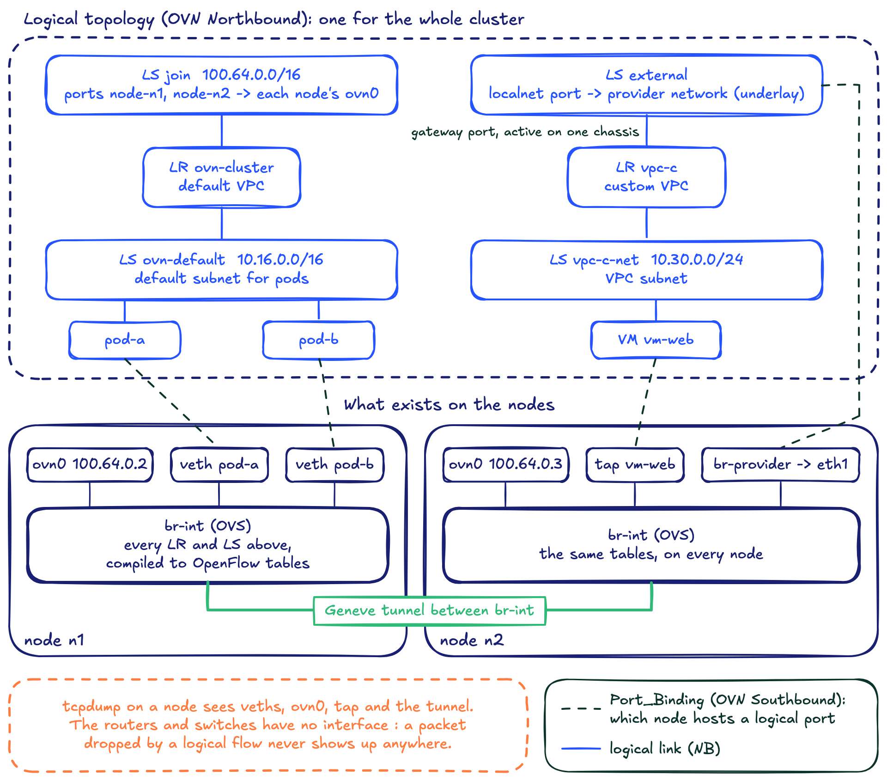
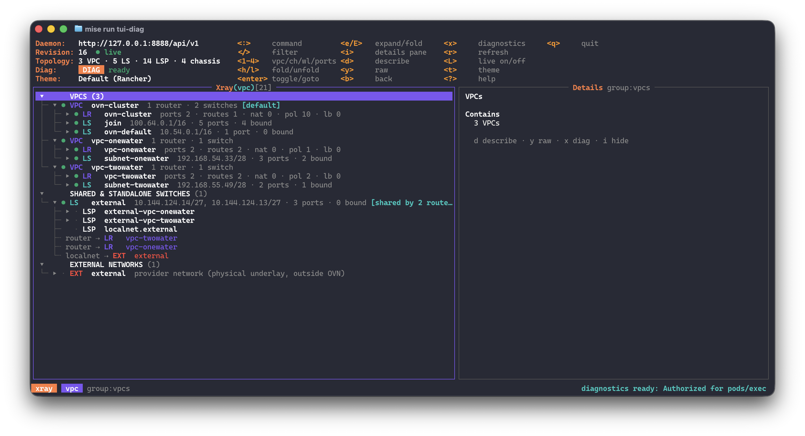
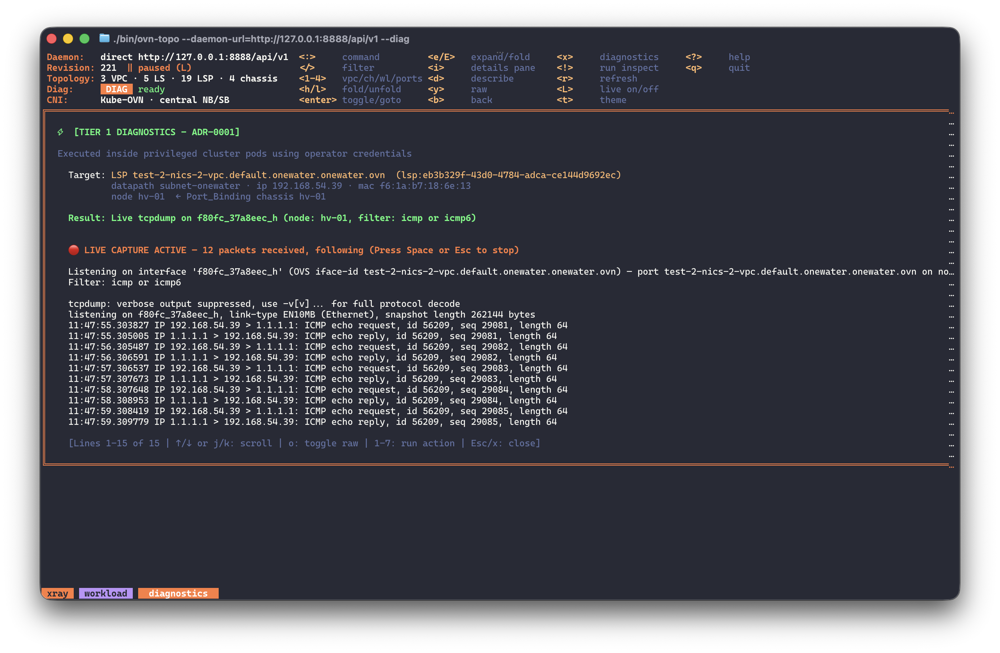
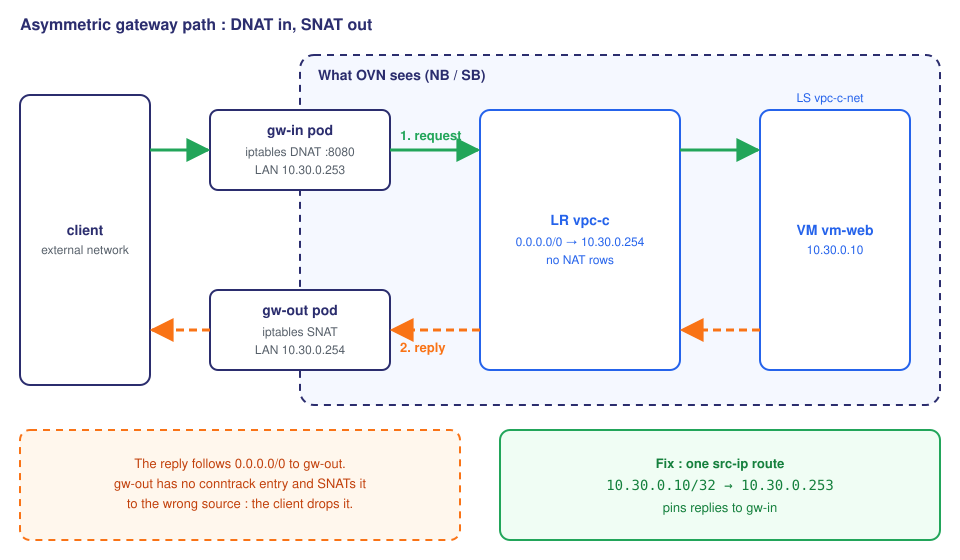
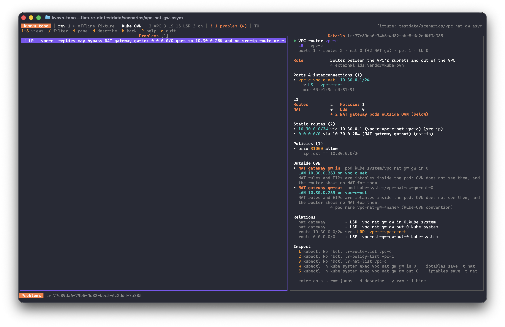

# Following a Packet Through OVN on KubeVirt, and Why I Built kvovn-topo

If you come from the VMware :simple-vmware: world, your Software-Defined Network is NSX. Its open source counterpart is [Open Virtual Network](https://www.ovn.org/en/){target="_blank"} (OVN). OVN is a solid foundation, and you find it in most hypervisor alternatives to VMware : [OpenStack](https://docs.openstack.org/neutron/latest/admin/ovn/index.html){target="_blank"} :simple-openstack: and, obviously, KubeVirt.

On Harvester :simple-suse:, the [kubeovn-operator addon](https://docs.harvesterhci.io/v1.9/advanced/addons/kubeovn-operator/){target="_blank"} brings Kube-OVN on top of OVN : VPCs, subnets, NAT gateways, EIPs. Connecting a VM to a VPC is easy enough. Knowing what happens to its packets is much harder.

I hit a few networking bugs on Harvester, and fixing them was the easy part. Most of the time went into finding where the packet went.

<!-- more -->

## Why a packet path is hard to follow

### Your usual tools stop working

On a classic hypervisor, you `ping`, you `tcpdump` the bridge, you read the routing table. With OVN, the routers and switches are not interfaces. They are logical objects, compiled into OpenFlow tables inside Open vSwitch on every node.

A packet dropped by a logical flow never reaches a virtual interface. There is nothing to capture. The VM's tap device stays silent, and `ip route` on the node tells you nothing about the VPC.


*One logical topology for the whole cluster. The `join` switch connects the default VPC to every node through `ovn0`, and the `external` switch reaches the underlay through a localnet port. On the nodes, all of it is OpenFlow tables in `br-int`.*

On classic Kubernetes, I reach for [netshoot](https://github.com/nicolaka/netshoot){target="_blank"} :simple-github:, a container packed with `tcpdump`, `dig`, `iperf` and friends. It is not enough here either : it sees one network namespace at a time, not the logical pipeline OVN runs between them.

### Every layer renames things

OVN has its own vocabulary. Kube-OVN puts its own abstractions on top, and ovn-kubernetes has different ones.

| Concept | Kube-OVN | OVN | ovn-kubernetes |
|---|---|---|---|
| Virtual router | `Vpc` | `Logical_Router` | `ovn_cluster_router`, `GR_<node>` |
| Virtual switch | `Subnet` | `Logical_Switch` | node switch, UDN |
| Source route | `policySrc` static route | `Static_Route policy=src-ip` | no CRD |
| NAT to the outside | `VpcNatGateway` (a pod) | nothing : iptables in the pod | local gateway mode : the host stack |

The NAT row caused the bug later in this post.

### The configuration is scattered

The OVN Northbound database (NB) holds the intent : routers, switches, routes, NAT. The Southbound database (SB) holds the reality : which chassis bound which port. The two are joined only by names.

Then the CNI adds its own layer. Kube-OVN CRDs describe the desired state, and a failed reconcile looks perfectly correct. Some state lives in neither database, but in iptables inside a pod. No single tool showed me all of it, down to the pod or VM at the end of the wire.

## What I wanted : two things

I started [kvovn-topo](https://github.com/coulof/kvovn-topo){target="_blank"} :simple-github: with two goals.

**1. See how the objects are organized.** Routers, switches, logical ports, chassis, down to the running pod or VM. NB and SB joined into one live graph, with Kubernetes names on top.


*The VPC tree : each VPC with its router and switches, plus the shared external switch and the underlay.*

**2. Trace and debug without twenty commands.** Finding the right node, the right OVS interface and the right container eats the time. So the diagnostics are contextual. Select an object, press `x`, and kvovn-topo runs [`ovn-trace`](https://www.ovn.org/support/dist-docs/ovn-trace.8.html){target="_blank"}, `tcpdump`, the OVS conntrack table ([`ovs-appctl dpctl/dump-conntrack`](https://www.openvswitch.org/support/dist-docs/ovs-dpctl.8.html){target="_blank"}) or `ovn-controller` logs for that object, on the node that hosts it.


*A live tcpdump on a VM's port : the tool resolved the OVS interface and the node from the Port_Binding.*

The same graph is also exposed to AI agents, more on that [below](#ask-an-agent-kvovn-topo-mcp).

A few hard design rules, given to the coding agent, made the tool safer :

- **Read-only.** It reads OVSDB directly and never writes. OVSDB has no read-only role, so read-only is enforced in code and by a lint rule in CI.
- **Kubernetes only for names.** The topology comes from OVN. Kubernetes only maps chassis to nodes and ports to pods and VMs.
- **Passive by default.** The exec-based diagnostics need `--diag` and `pods/exec` RBAC. Without them, the tool only observes.
- **No exposed endpoint.** The client reaches the daemon through the Kubernetes API service proxy.

## The packet OVN never saw

Here is an actual "bug", or rather a Kube-OVN misconfiguration, that kvovn-topo helped me solve. I rebuilt it as a lab scenario with simpler names and IPs.

A custom VPC `vpc-c` has two Kube-OVN VPC NAT gateways :

- `gw-out` (LAN IP 10.30.0.254) takes the VPC's `0.0.0.0/0` route and SNATs outbound traffic.
- `gw-in` (LAN IP 10.30.0.253) DNATs port 8080 on its EIP to the VM `vm-web` (10.30.0.10).

### The symptom

Inbound connections to 8080 hang. The SYN reaches `vm-web`, so DNAT works. The connection never completes.

OVN says everything is fine. The route table is short and sane, and the NAT table is empty :

```console
$ kubectl ko nbctl lr-route-list vpc-c
IPv4 Routes
Route Table <main>:
           10.30.0.0/24                10.30.0.1 src-ip
              0.0.0.0/0              10.30.0.254 dst-ip
$ kubectl ko nbctl lr-nat-list vpc-c
$
```

Yet this VPC does NAT twice.

### What was really happening

A VPC NAT gateway is a pod. Its EIPs, DNAT and SNAT rules are iptables inside that pod. OVN sees two ordinary logical switch ports and nothing else.

The request goes in through `gw-in`. The reply from `vm-web` reaches the router `vpc-c`, which knows nothing about that DNAT.

The router sends the reply along `0.0.0.0/0` to `gw-out`. `gw-out` has no conntrack entry for the flow and SNATs the reply to its own EIP. The client expected an answer from `gw-in`'s EIP, so it drops the packet. That is an asymmetric return.


*Both gateways are half outside OVN's view. The router routes the reply by destination, and nothing pins it back to `gw-in`.*

### The fix

One `src-ip` route that pins replies from `vm-web` back to `gw-in` :

```yaml
apiVersion: kubeovn.io/v1
kind: Vpc
metadata:
  name: vpc-c
spec:
  namespaces: [vpc-c]
  staticRoutes:
    - cidr: 0.0.0.0/0
      nextHopIP: 10.30.0.254   # gw-out, default egress
      policy: policyDst
    - cidr: 10.30.0.10/32
      nextHopIP: 10.30.0.253   # replies from vm-web go back through gw-in
      policy: policySrc
```

OVN picks the longest matching prefix across `dst-ip` and `src-ip` routes. A `/32` source route beats `0.0.0.0/0`, so the reply goes back through the gateway that translated the request.

### What kvovn-topo does with it now

NAT gateway pods now show up as an "Outside OVN" hop on their router. With `--diag`, `!` runs `iptables-save -t nat` inside the gateway pod.

The Problems view (key `4`) also flags the pattern :

```text
! LR   vpc-c  replies may bypass NAT gateway gw-in: 0.0.0.0/0 goes to 10.30.0.254
              and no src-ip route or reroute leads to 10.30.0.253 (heuristic)
```

It flags `gw-in` and not `gw-out`, because the default route already leads to `gw-out`. The check is labeled heuristic : without exec, the tool cannot know whether `gw-in` actually DNATs anything.

<!-- TODO: capture problems-vpc-c.png, then uncomment

*The Problems view on the `vpc-nat-gw-asym` scenario, with the router's details on the right.*
-->

!!! tip "Know which hops your SDN cannot see"
    The VPC NAT gateway is not the only place where traffic leaves OVN's view :

    - **Kube-OVN VPC NAT gateway** : iptables inside a pod.
    - **Kube-OVN default VPC with `natOutgoing` in centralized mode** : a policy reroute plus iptables on the gateway node.
    - **ovn-kubernetes local gateway mode** : traffic goes through the host network stack via `ovn-k8s-mp0`.

    In each case `lr-nat-list` comes back empty while NAT happens.

## Sidenotes

### Ask an agent : `kvovn-topo mcp`

`kvovn-topo mcp` is an MCP server over stdio. It gives an AI agent four read-only tools on the same graph as the TUI : `find`, `get_graph`, `get_node` and `list_chassis`. Plugging it into Claude Code is one line :

```bash
claude mcp add kvovn-topo -- kvovn-topo mcp
```

Then ask in plain words, for example "which node hosts the port of VM `vm-web` ?". The MCP server never runs the exec-based diagnostics, even with `--diag`.

<!-- TODO: MCP screenshot -->

### Kube-OVN v ovn-kubernetes, one OVN, two control planes, two designs

Kube-OVN and ovn-kubernetes both drive OVN but they took very different paths.

Kube-OVN keeps a classic design : a central `kube-ovn-controller` and one central NB/SB pair. You read the whole topology from one place.

ovn-kubernetes moved to [interconnect mode](https://www.redhat.com/en/blog/how-the-new-ovn-kubernetes-architecture-helps-with-scaling-openshift){target="_blank"} :simple-redhat: with OpenShift 4.14. Every node is its own zone, with its own NB, SB and `northd`, listening only on a local unix socket. There is no central database. Each zone holds a near-complete copy of the cluster's logical objects, and a transit switch with `remote` ports stitches the zones together.

When I connected kvovn-topo to an OpenShift cluster, the first thing it said was `no such host` : there was no NB service to connect to.

The two designs need different collectors on top of the same OVN core. kvovn-topo keeps the CNI-specific parts behind a flavor adapter, and today it reads one ovn-kubernetes zone at a time. A merged, cluster-wide view is designed but not built yet. More on that in a later post.

## Try it

!!! warning "Pre-release"
    The commands below point to kvovn-topo v0.1.0.

Install the daemon in the cluster (RKE2 or Harvester) :

```bash
helm install kvovn-topo oci://ghcr.io/coulof/charts/kvovn-topo --namespace kube-system
```

Install the client on Linux (amd64) or macOS (arm64) :

```bash
VERSION=0.1.0
OS=$(uname -s | tr '[:upper:]' '[:lower:]')
ARCH=$(uname -m | sed 's/x86_64/amd64/;s/aarch64/arm64/')
curl -fsSL https://github.com/coulof/kvovn-topo/releases/download/v${VERSION}/kvovn-topo_${VERSION}_${OS}_${ARCH}.tar.gz | tar -xz kvovn-topo
sudo install kvovn-topo /usr/local/bin/
```

## Conclusion

kvovn-topo is my most ambitious vibe-coded project so far. I believe it will help SUSE Virtualization and OpenShift users, whether they run diagnostics by hand or through an agent.

I would love community feedback on this one. Poke me directly or open an issue on [GitHub](https://github.com/coulof/kvovn-topo/issues){target="_blank"} :simple-github:. The next big step is to bring the debugging tools into a [Rancher UI extension](https://extensions.rancher.io/){target="_blank"} :simple-rancher:.

## Further reading

- [kvovn-topo on GitHub](https://github.com/coulof/kvovn-topo){target="_blank"} :simple-github:
- [ADR-0004 : CNI flavors and opaque hops](https://github.com/coulof/kvovn-topo/blob/main/docs/adr/0004-cni-flavors-and-opaque-hops.md){target="_blank"} :simple-github:, the design behind the NAT gateway check
- [ADR-0005 : ovn-kubernetes interconnect](https://github.com/coulof/kvovn-topo/blob/main/docs/adr/0005-ovnk-interconnect.md){target="_blank"} :simple-github:
- [Harvester VPC NAT gateway](https://docs.harvesterhci.io/v1.9/networking/kubeovn-vpcnatgateway){target="_blank"} :simple-suse: and [Kube-OVN gateway options](https://kube-ovn.readthedocs.io/zh-cn/latest/en/vpc/vpc/){target="_blank"} :material-network-outline:
- [Kube-OVN VPC configuration and static routes](https://kube-ovn.readthedocs.io/zh-cn/stable/en/guide/vpc/){target="_blank"} :material-network-outline:
- [How the new OVN-Kubernetes architecture helps with scaling OpenShift](https://www.redhat.com/en/blog/how-the-new-ovn-kubernetes-architecture-helps-with-scaling-openshift){target="_blank"} :simple-redhat:
